# reanimated_dartnative

[React Native Reanimated](https://docs.swmansion.com/react-native-reanimated/) for
[DartNative](https://dartnative.com): shared values, spring, timing and decay
animations, animated styles, layout animations, CSS animations, and device
sensors.

| | | |
| :---: | :---: | :---: |
| 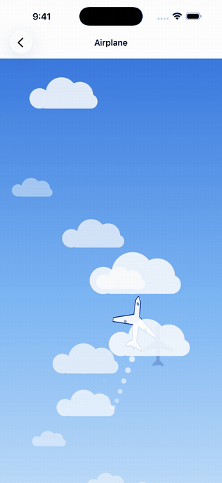<br>Airplane | <br>Chat heads | 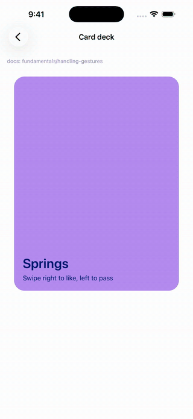<br>Card deck |
| <br>Flip card | 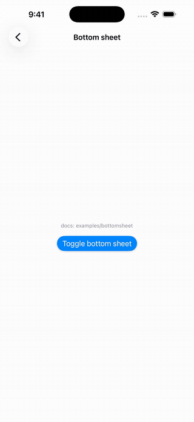<br>Bottom sheet | 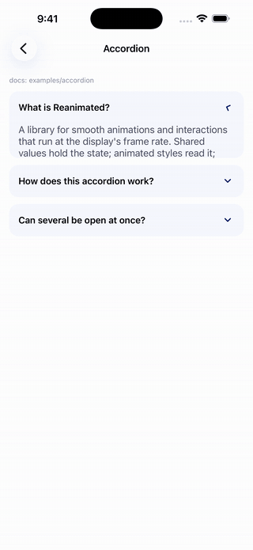<br>Accordion |
| 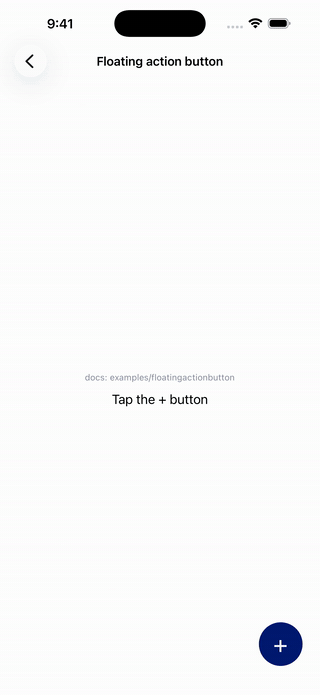<br>Floating action button | 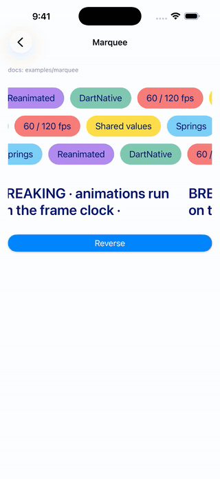<br>Marquee | 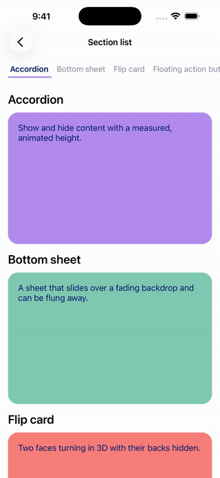<br>Section list |
| 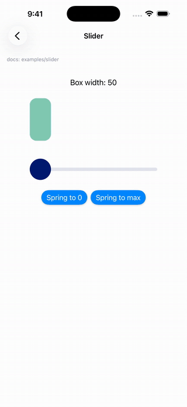<br>Slider | 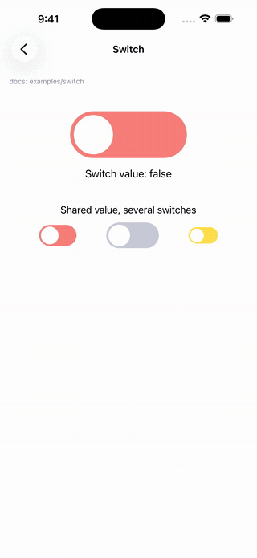<br>Switch | 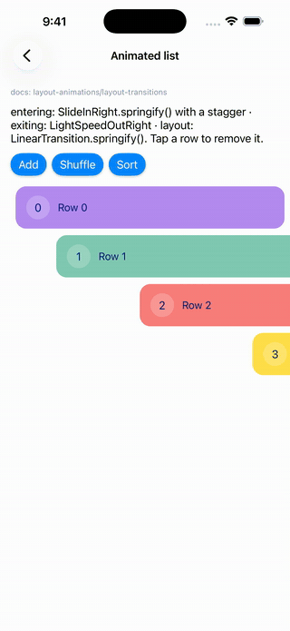<br>Animated list |
| 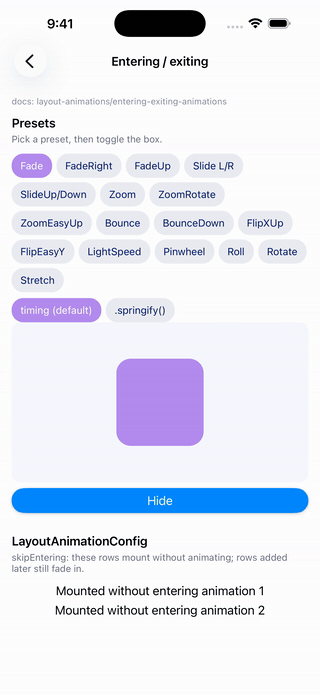<br>Entering / exiting | 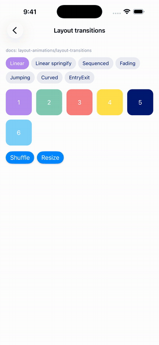<br>Layout transitions | 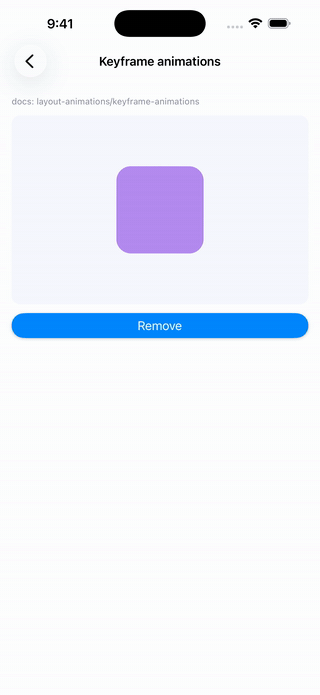<br>Keyframe |
| 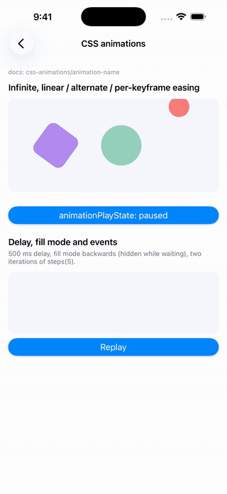<br>CSS animations | 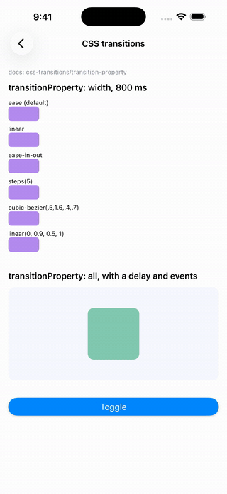<br>CSS transitions | 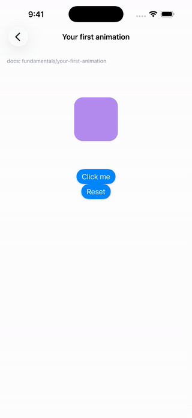<br>Your first animation |

*Recorded from the example app on an iOS simulator. The gestures are
scripted, and the airplane is steered by script because simulators have no
motion sensors.*

**[See every example with its full code →](doc/EXAMPLES.md)**

- **Runs on the display's clock.** Animations advance once per display
  refresh (`CADisplayLink` on iOS, `Choreographer` on Android) through
  DartNative's `Ticker`, at 60 or 120 Hz, and pause in the background.
- **Rebuilds only what animates.** `AnimatedView` listens to its own style.
  Writing a shared value never rebuilds your screen.
- **Tracks dependencies for you.** Animated styles, derived values, animated
  props and reactions record the shared values they read, so you never write
  a dependency list.
- **Behaves like Reanimated 4.** Spring defaults, velocity carried into the
  next animation, reduce-motion rules, `withRepeat(reverse:)`, rubber-band
  decay and Oklab colors all match.
- **Reads sensors natively.** CoreMotion and SensorManager readings, and the
  system's reduce-motion setting, reach Dart over FFI with no platform
  channels.

## Contents

- [Installation](#installation)
- [Your first animation](#your-first-animation)
- [Guide](#guide)
  - [Shared values](#shared-values)
  - [Animated styles and AnimatedView](#animated-styles-and-animatedview)
  - [Animations](#animations)
  - [Animating when state changes](#animating-when-state-changes)
  - [Derived values, reactions and animated props](#derived-values-reactions-and-animated-props)
  - [Gestures](#gestures)
  - [Layout animations](#layout-animations)
  - [CSS animations and transitions](#css-animations-and-transitions)
  - [Scroll](#scroll)
  - [Sensors](#sensors)
  - [Reduced motion](#reduced-motion)
  - [Frame callbacks, measuring, interpolation](#frame-callbacks-measuring-interpolation)
- [DartNative layout rules that matter for animation](#dartnative-layout-rules-that-matter-for-animation)
- [API reference](#api-reference)
- [Coming from Reanimated](#coming-from-reanimated)
- [Not available](#not-available)
- [Example app](#example-app) and [every example with its code](doc/EXAMPLES.md)
- [Testing](#testing)
- [Troubleshooting](#troubleshooting)

## Installation

```yaml
dependencies:
  reanimated_dartnative:
    hosted: https://dartpub.dev
    version: ^0.1.0
```

```sh
dn pub get
cd ios && pod install   # iOS only
```

`dn pub get` adds `ReanimatedFFIBindings.loadSymbols()` to your app's
generated `lib/dartnative_plugin_registrant.dart`. Keep
`DartNativePluginRegistrant.registerAll()` as the first line of `main()`:

```dart
void main() {
  DartNativePluginRegistrant.registerAll();
  runApp(const MyApp());
}
```

Permissions:

- **None for the motion sensors** on either platform.
- **iOS rotation in `xTrueNorthZVertical`** needs location permission, as
  CoreMotion requires.

Everything else is plain Dart.

## Your first animation

The docs' first example: a box that grows by 50 with a spring each time you
press the button.

```dart
import 'package:dartnative/dartnative.dart';
import 'package:reanimated_dartnative/reanimated_dartnative.dart';

class Box extends StatefulWidget {
  const Box({super.key});

  @override
  State<Box> createState() => _BoxState();
}

class _BoxState extends State<Box> with ReanimatedStateMixin {
  // 1. A shared value holds the state that animates.
  late final width = useSharedValue(100.0);

  // 2. An animated style reads it; it re-runs whenever width changes.
  late final animatedStyle = useAnimatedStyle(() => AnimatedStyle(width: width.value));

  // 3. Assigning an animation animates it.
  void handlePress() => width.set(withSpring(width.value + 50));

  @override
  Widget build(BuildContext context) => Column(children: [
        // 4. An AnimatedView shows the style, and only it updates per frame.
        AnimatedView(
          style: Styles([
            const AnimatedStyle(height: 100, backgroundColor: Color(0xFFB58DF1), borderRadius: 20),
            animatedStyle,
          ]),
        ),
        ElevatedButton(onPressed: handlePress, child: const Text('Click me')),
      ]);
}
```

`ReanimatedStateMixin` gives the `State` the `use*` hooks and disposes
everything they create when the widget goes away. Create shared values and
styles as `late final` fields, or in `initState`, and never in `build`.

## Guide

### Shared values

```dart
late final offset = useSharedValue(0.0);

offset.value;                       // read (also offset.get())
offset.value = 120;                 // set instantly, cancelling any animation
offset.set(withTiming(120));        // animate (Reanimated's offset.value = withTiming(120))
offset.set((double v) => v + 10);   // update from the current value
offset.modify((v) => v);            // notify after mutating a list or map in place
cancelAnimation(offset);            // stop where it is
```

- **Animatable types:** `double`/`int`, `Color`, `Offset`, `Size` and
  `List<double>`. Colors animate per channel in linear light. An `Offset`
  can be the target of a spring or decay, which makes 2D motion one value.
- **Color formats:** anywhere a color is expected, you can pass a `Color`,
  an ARGB int, or a CSS string (`'#b58df1'`, `'rgba(0,0,0,.5)'`,
  `'hsl(…)'`, `'teal'`).
- **Usable as a `ValueListenable`:** `ValueListenableBuilder`,
  `AnimatedBuilder` and `addListener` all work.
- **No rebuilds:** writing never rebuilds anything except the views that
  read the value.

### Animated styles and AnimatedView

`AnimatedView` is Reanimated's `Animated.View`. Its `style` can be:

- a fixed `AnimatedStyle`
- the handle returned by `useAnimatedStyle`
- several of these merged with `Styles([...])`, where later ones win (like
  `style={[a, b]}`)

```dart
late final style = useAnimatedStyle(() => AnimatedStyle(
      translateX: x.value,
      scale: pressed.value ? 1.2 : 1,
      backgroundColor: pressed.value ? const Color(0xFFFFE04B) : const Color(0xFFB58DF1),
    ));

AnimatedView(style: Styles([baseStyle, style]), child: ...)
```

| Property | |
| --- | --- |
| `opacity` | 0–1 |
| `translateX`, `translateY` | logical pixels |
| `scale`, `scaleX`, `scaleY` | |
| `rotate` | radians, in the screen's plane. Write degrees with `deg(45)` |
| `rotateX`, `rotateY`, `perspective` | 3D rotation, seen from `perspective` px (default 900) |
| `width`, `height` | lays the view out at this size |
| `backgroundColor`, `borderRadius` | |

Transforms apply about the view's center, in this order: translate, rotate,
3D rotation, then scale.

`AnimatedView` also takes the following parameters:

- `onLayout` (its size after layout, as React Native's `onLayout`)
- `backfaceVisibility: false` (hides the view while a 3D rotation shows its
  back, for flip cards)
- `entering`, `exiting` and `layout` ([layout animations](#layout-animations))
- `cssAnimations` and `cssTransition` ([CSS](#css-animations-and-transitions))
- `sharedTransitionTag`

### Animations

```dart
x.set(withTiming(100));                                   // 300 ms, Easing.inOut(Easing.quad)
x.set(withTiming(100, duration: const Duration(seconds: 1), easing: Easing.out(Easing.exp)));
x.set(withSpring(100));                                   // mass 4, stiffness 900, damping 120
x.set(withSpring(100, dampingRatio: 0.5, duration: const Duration(milliseconds: 600))); // bouncy, duration-based
x.set(withDecay(velocity: 800, clamp: (0, 300), rubberBandEffect: true));

x.set(withSequence([withTiming(-10), withRepeat(withTiming(10), numberOfReps: 5, reverse: true), withTiming(0)]));
x.set(withDelay(const Duration(milliseconds: 400), withSpring(0)));
x.set(withRepeat(withTiming(1), numberOfReps: -1, reverse: true)); // forever
x.set(withClamp(min: 0, max: 200, withSpring(250, dampingRatio: 0.3)));

x.set(withSpring(100, callback: (finished) => print(finished ? 'done' : 'interrupted')));
```

- **Interruption.** A new animation starts from wherever the current one is.
  A spring with no explicit `velocity` also inherits the current velocity,
  so interrupting looks natural.
- **Easings.** `Easing` has Reanimated's curves: `linear`, `ease`, `quad`,
  `cubic`, `poly(n)`, `sin`, `circle`, `exp`, `elastic()`, `back()`,
  `bounce`, `bezier(x1, y1, x2, y2)` and `steps(n)`. Wrap them with `in_`,
  `out` and `inOut`. `in` is a Dart keyword, hence `in_`.

### Animating when state changes

Reanimated code often animates *inside* a style:
`useAnimatedStyle(() => ({ height: withTiming(open.value ? 200 : 0) }))`.
The Dart form is `useDerivedAnimation`. It is a shared value that animates
to whatever its updater returns, and re-runs whenever a shared value the
updater read changes:

```dart
late final isOpen = useSharedValue(false);
late final height = useDerivedAnimation(0.0, () => withTiming(isOpen.value ? 200.0 : 0.0));
late final style = useAnimatedStyle(() => AnimatedStyle(height: height.value));

void toggle() => isOpen.value = !isOpen.value;   // the height animates; nothing rebuilds
```

This is how the example app's accordion, bottom sheet, switch, floating
action button and flip card work. It also chains: in the chat heads, each
bubble is `useDerivedAnimation(..., () => withSpring(ahead.value))`.

### Derived values, reactions and animated props

```dart
late final progress = useSharedValue(0.0);
late final width = useDerivedValue(() => progress.value * 250);            // read-only, recomputes
late final label = useAnimatedProps(() => 'Width: ${width.value.round()}'); // any type

@override
void initState() {
  super.initState();
  useAnimatedReaction(() => width.value > 200, (isOver, wasOver) {
    if (isOver != wasOver) height.set(withSpring(isOver ? 120.0 : 40.0));
  });
}

// Rebuilds only the Text:
AnimatedPropsBuilder(props: label, builder: (context, text) => Text(text))
```

Use animated props for anything that isn't a style: a painter's radius, a
label, a progress value. `AnimatedPropsBuilder` rebuilds just its builder.

### Gestures

Drag with `GestureDetector`, then hand the release velocity to a spring or a
decay:

```dart
GestureDetector(
  onPanUpdate: (d) => offset.value += d.delta.dx,
  onPanEnd: (d) => offset.set(withDecay(
    velocity: d.velocity.pixelsPerSecond.dx,
    clamp: (-150, 150),
    rubberBandEffect: true,
  )),
  // The detector covers the whole area the ball moves in.
  child: SizedBox(height: 200, child: Center(child: AnimatedView(style: ballStyle))),
)
```

> **Put the detector around the area the view moves in, not around the
> view.** A view moved by `translateX`/`translateY` keeps its touch area
> where it was laid out (in Flutter too). Wrap the whole stage. If you need
> to know whether the touch started on the view, check
> `details.localPosition` in `onPanStart`, as the chat heads example does.

### Layout animations

```dart
AnimatedPresence(children: [
  for (final item in items)
    AnimatedView(
      key: ValueKey(item.id),
      entering: SlideInRight().springify().dampingRatio(0.75),
      exiting: FadeOut().duration(const Duration(milliseconds: 200)),
      layout: LinearTransition(),
      child: Row(...),
    ),
])
```

- **Presets.** Every Reanimated entering and exiting family is available,
  each in In and Out forms with their directions: Fade, Slide, Zoom, Bounce,
  Flip, LightSpeed, Pinwheel, Roll, Rotate and Stretch.
- **Builder modifiers.** `.duration()`, `.delay()`, `.randomDelay()`,
  `.easing()`, `.springify()`, `.damping()`, `.mass()`, `.stiffness()`,
  `.dampingRatio()`, `.overshootClamping()`, `.reduceMotion()`,
  `.withInitialValues()`, `.withTargetValues()` and `.withCallback()`.
- **`exiting` needs an `AnimatedPresence`** around the list children leave
  from (with keyed children). In React Native a component plays its exit on
  unmount; in DartNative a widget is gone as soon as its parent rebuilds
  without it, so `AnimatedPresence` keeps it until the animation ends.
- **`layout` transitions.** `LinearTransition`, `SequencedTransition`,
  `FadingTransition`, `JumpingTransition`, `CurvedTransition` and
  `EntryExitTransition` animate a view from its old position and size to
  its new one after a rebuild.
- **`Keyframe`.**

  ```dart
  final wobble = Keyframe({
    0: const AnimatedStyle(rotate: 0),
    45: KeyframeStyle(rotate: deg(100), easing: Easing.exp),
    100: const AnimatedStyle(rotate: 0),
  }).duration(const Duration(seconds: 2));
  ```

- **Custom animations.** `CustomEntering`/`CustomExiting((values) => (initial: ..., target: ...))`.
- **Skipping.** `LayoutAnimationConfig(skipEntering: true, ...)` skips
  entering animations on first mount.
- **Shared elements.** `AnimatedView(sharedTransitionTag: 'photo-3')` on both
  screens flies the view across a `Navigator.push`, using DartNative's
  `Hero`.

### CSS animations and transitions

Reanimated 4's CSS API, for animations that don't depend on shared values:

```dart
AnimatedView(
  style: box,
  cssAnimations: [
    CSSAnimation(
      keyframes: CSSKeyframes({'to': AnimatedStyle(rotate: deg(360))}),
      duration: const Duration(seconds: 3),
      iterationCount: double.infinity,
      timingFunction: CSSTimingFunction.linear,
    ),
  ],
)

AnimatedView(
  style: AnimatedStyle(width: expanded ? 280 : 60, height: 28),  // change with setState
  cssTransition: CSSTransition(properties: const ['width'], duration: const Duration(milliseconds: 800)),
)
```

- **Animation options.** `delay` (negative values start partway through),
  `iterationCount`, `direction`, `fillMode` and `playState`.
- **Per-keyframe timing.** Use `KeyframeStyle(easing:)`.
- **Animation callbacks.** `onStart`, `onIteration`, `onEnd` and
  `onCancel`. Transitions have `onRun`, `onStart`, `onEnd` and `onCancel`.
- **Timing functions.** `CSSTimingFunction` has `ease`, `easeIn`,
  `easeOut`, `easeInOut`, `linear`, `stepStart`, `stepEnd`,
  `cubicBezier()`, `steps(n, position)` and `linearPoints()` (CSS
  `linear()`).

### Scroll

```dart
final controller = ScrollController();
late final scrollY = useScrollOffset(controller);
late final headerStyle = useAnimatedStyle(() => AnimatedStyle(
      height: interpolate(scrollY.value, [0, 160], [160, 64], Extrapolation.clamp),
      backgroundColor: interpolateColor(scrollY.value, [0, 160], ['#b58df1', '#001a72']),
    ));

useAnimatedScrollHandler(controller,
    onBeginDrag: (e, ctx) => ..., onEndDrag: ..., onMomentumEnd: ...);
scrollTo(controller, 0, 1200, true);

ListView(controller: controller, children: ...)
```

These take the `ScrollController` you give the scroll view, where Reanimated
takes an animated ref.

### Sensors

```dart
late final gravity = useAnimatedSensor(SensorType.gravity);   // AnimatedSensor<Value3D>
late final rotation = useAnimatedSensor(SensorType.rotation,  // AnimatedSensor<ValueRotation>
    const SensorConfig(interval: SensorInterval.milliseconds(20)));

late final style = useAnimatedStyle(() => AnimatedStyle(
      translateX: -gravity.sensor.value.x * 20,   // toward the lower edge
      translateY: gravity.sensor.value.y * 20,
    ));

if (!gravity.isAvailable) { /* simulator, or no such sensor */ }
```

**Axes and units are the same on iOS and Android.** x points to the
device's right edge, y to its top edge and z out of the screen.

| Sensor | Reading | Flat, screen up | Right edge down | Upright |
| --- | --- | --- | --- | --- |
| `accelerometer`, `gravity` | m/s², the force holding the device up | z = +9.81 | x < 0 | y = +9.81 |
| `gyroscope` | rad/s about each axis | | | |
| `magneticField` | µT | | | |
| `rotation` | quaternion plus `yaw`, `pitch`, `roll` (rad) | | | |

Note that the screen's y axis points down while the device's y points up, so
"slide toward the lower edge" is `translateX: -x * k, translateY: y * k`. The
example app's `test/tilt_mapping_test.dart` checks this against simulated
device poses.

Configuration:

- **`SensorInterval.auto`** follows the screen refresh rate. Use
  `SensorInterval.milliseconds(n)` for a fixed rate, at most about 100 Hz.
- **`adjustToInterfaceOrientation`** (on by default) rotates x and y to
  follow the screen in landscape.
- **`iosReferenceFrame`** sets the rotation reference frame on iOS.
- **Smoothing.** To smooth readings, spring toward them. Each new spring
  inherits the last one's velocity:
  `useAnimatedReaction(() => gravity.sensor.value, (g, _) => x.set(withSpring(-g.x * 20)))`.

### Reduced motion

`useReducedMotion()` reads the device setting: Reduce Motion on iOS, Remove
animations on Android. `ReducedMotion.onChange` fires when it changes.
Every animation takes `reduceMotion: ReduceMotion.system | always | never`,
and `system` is the default. When reduce motion applies:

- Timing and spring animations jump to their end.
- Decay animations stay where they are.
- Delays are skipped.
- Infinite repeats, and reversed repeats with an even count, don't start.
- Entering and layout animations jump to their end.
- Exiting animations are skipped.

`ReducedMotionConfigScope(mode: ReduceMotion.never, child: ...)` overrides
the setting app-wide while it is mounted.

### Frame callbacks, measuring, interpolation

- **Frame callbacks.**
  - `useFrameCallback((info) {...})` runs every frame; `info` has
    `timestamp`, `timeSincePreviousFrame` and `timeSinceFirstFrame`.
  - `setActive(bool)` starts and stops it.
  - `useTimestamp()` is a shared value of milliseconds since it started.
- **Measuring.**
  - `final ref = useAnimatedRef();` then pass `Container(key: ref)`.
  - `measure(ref)` returns the size and `pageX`/`pageY` on screen. Its
    `x`/`y` are relative to `relativeTo:`, because DartNative exposes no
    parent view.
  - `getRelativeCoords(ref, x, y)` converts screen coordinates to the view's.
- **Interpolation.**
  - `interpolate(v, [0, 1], [10, 50], Extrapolation.clamp)`; pass an
    `ExtrapolationConfig` for different behaviour on each side.
  - `interpolateColor(v, [0, 1], ['red', 'blue'], ColorSpace.rgb | hsv | lab)`.
    RGB blends in linear light, and `lab` is Oklab.
- **Helpers.** `contrastColor` and `clamp`.
- **Debugging.** `ReanimatedDebug.slowAnimations = true` plays everything
  10× slower.

## DartNative layout rules that matter for animation

These come from DartNative and catch everyone porting Flutter code:

1. **A moved view's touch area stays behind.** See [Gestures](#gestures):
   put the `GestureDetector` around the whole area.
2. **`Stack` matches children by index, not by key.** If you reorder
   children inside a `Stack`, give each index a fixed role and change what
   it shows. The card deck example does this. `Column` and `Row` behave
   normally.
3. **`Positioned` must be the outermost wrapper of a `Stack` child**, and a
   `Stack` whose children are all `Positioned` collapses to zero size. Add
   one non-positioned child, or give the `Stack` a size.
4. **A horizontal scroll view in a `Column` needs a height.** Wrap it in a
   `SizedBox(height: …)`.
5. **Native views keep the last property value you set when you later pass
   `null`.** Pass explicit colors for every state (for example selected and
   unselected) rather than `color: selected ? c : null`.

## API reference

### Core

| API | Notes |
| --- | --- |
| `useSharedValue`, `SharedValue`, `makeMutable`, `cancelAnimation` | `.value`, `get()`, `set(valueOrAnimationOrUpdater)`, `modify()`, `isAnimating`, `velocity` |
| `useAnimatedStyle`, `AnimatedStyle`, `Styles`, `deg()` | Style properties listed [above](#animated-styles-and-animatedview) |
| `AnimatedView` | `style`, `entering`, `exiting`, `layout`, `cssAnimations`, `cssTransition`, `sharedTransitionTag`, `onLayout`, `backfaceVisibility`, `child` |
| `useDerivedValue` | Read-only computed value |
| `useDerivedAnimation` | Animates to what its updater returns, re-running when a dependency changes |
| `useAnimatedReaction` | `(prepare, react(current, previous))`; `react` first runs with `previous` null |
| `useAnimatedProps`, `AnimatedPropsBuilder` | Props of any type |
| `useAnimatedRef`, `measure`, `getRelativeCoords` | |
| `ReanimatedStateMixin` | The `use*` hooks on a `State`, disposed with it |

### Animations

| API | Defaults (Reanimated 4) |
| --- | --- |
| `withTiming(to, duration:, easing:, reduceMotion:, callback:)` | 300 ms, `Easing.inOut(Easing.quad)` |
| `withSpring(to, mass:, stiffness:, damping:, duration:, dampingRatio:, velocity:, overshootClamping:, energyThreshold:, clamp:, …)` | Physics: mass 4, stiffness 900, damping 120. Duration-based: 550 ms perceptual (settles in about 1.5×), dampingRatio 1 |
| `withDecay(velocity:, deceleration:, clamp:, velocityFactor:, rubberBandEffect:, rubberBandFactor:, …)` | 0.998, 1, rubber band 0.6 (needs `clamp`) |
| `withSequence([…])`, `withRepeat(a, numberOfReps:, reverse:)`, `withDelay(d, a)`, `withClamp(a, min:, max:)` | Repeats 2 times by default; ≤ 0 means forever; `reverse` is for animation functions only |
| `Easing.*` | See [Animations](#animations) |

### Layout

| API |
| --- |
| `FadeIn`/`FadeOut` (+ `Right`/`Left`/`Up`/`Down`), `SlideIn*`/`SlideOut*`, `ZoomIn*`/`ZoomOut*` (+ `Rotate`, `Easy*`), `BounceIn*`/`BounceOut*`, `FlipIn*`/`FlipOut*`, `LightSpeed*`, `PinwheelIn`/`Out`, `Roll*`, `Rotate*`, `Stretch*` |
| `Keyframe`, `KeyframeStyle`, `CustomEntering`, `CustomExiting` |
| `LinearTransition`, `SequencedTransition`, `FadingTransition`, `JumpingTransition`, `CurvedTransition`, `EntryExitTransition` |
| `AnimatedPresence`, `LayoutAnimationConfig`, `ReducedMotionConfigScope` |

### CSS, scroll, device, utilities

| API |
| --- |
| `CSSAnimation`, `CSSKeyframes`, `CSSTransition`, `CSSTimingFunction`, `AnimationDirection`, `AnimationFillMode`, `AnimationPlayState` |
| `useScrollOffset`, `useAnimatedScrollHandler`, `scrollTo` |
| `useAnimatedSensor`, `SensorType`, `SensorConfig`, `SensorInterval`, `IOSReferenceFrame`, `Value3D`, `ValueRotation` |
| `useReducedMotion`, `ReducedMotion`, `ReducedMotionConfig`, `ReduceMotion` |
| `useFrameCallback`, `useTimestamp`, `interpolate`, `Extrapolation`, `interpolateColor`, `ColorSpace`, `contrastColor`, `parseColor`, `clamp`, `ReanimatedDebug`, `AnimationClock` |

## Coming from Reanimated

| Reanimated (TypeScript) | reanimated_dartnative |
| --- | --- |
| `const sv = useSharedValue(0)` | `late final sv = useSharedValue(0.0);` |
| `sv.value = withSpring(1)` | `sv.set(withSpring(1))` |
| `useAnimatedStyle(() => ({ transform: [{ translateX: x.value }] }))` | `useAnimatedStyle(() => AnimatedStyle(translateX: x.value))` |
| `height: withTiming(open.value ? 200 : 0)` inside a style | `useDerivedAnimation(0.0, () => withTiming(open.value ? 200.0 : 0.0))` |
| `<Animated.View style={[styles.box, animatedStyle]} />` | `AnimatedView(style: Styles([box, animatedStyle]))` |
| `withTiming(1, { duration: 300 }, cb)` | `withTiming(1, duration: Duration(milliseconds: 300), callback: cb)` |
| `withRepeat(a, -1, true)` | `withRepeat(a, numberOfReps: -1, reverse: true)` |
| `withSequence(a, b)` / `withClamp({min: 0}, a)` | `withSequence([a, b])` / `withClamp(min: 0, a)` |
| `'45deg'` | `deg(45)` |
| `entering={FadeIn.duration(500)}` | `entering: FadeIn().duration(Duration(milliseconds: 500))` |
| `exiting={FadeOut}` | `exiting: FadeOut()` inside an `AnimatedPresence` |
| `onLayout={e => …}` | `AnimatedView(onLayout: (size) => …)` |
| `useAnimatedRef()` on a scroll view | the scroll view's `ScrollController` |
| `Easing.in(f)` | `Easing.in_(f)` |
| `runOnJS(f)(x)` | `f(x)`, since there is one thread |

## Not available

- **Worklets and threads** (`runOnUI`, `runOnJS`, `scheduleOnRN`). These
  aren't needed, because your code already runs on the UI thread, once per
  frame.
- **`setNativeProps`, `dispatchCommand`, `useEvent`, `useHandler` and
  `useComposedEventHandler`.** These are React Native internals; rebuild
  widgets and use closures instead.
- **`useAnimatedKeyboard`** is deprecated in Reanimated 4. Use
  `MediaQuery.viewInsetsOf(context)`.
- **CSS pseudo-selectors and skew transforms.** DartNative has no skew, so
  the LightSpeed presets slide and fade without it.
- **`sharedTransitionStyle`.** DartNative's `Hero` decides the flight.

## Example app

`example_app/` has 31 screens, each in its own file in `lib/src/screens/`,
with reusable widgets in `lib/src/components/`:

- **The Reanimated site's examples:**
  - accordion
  - bottom sheet
  - flip card
  - floating action button
  - marquee
  - section list
  - slider
  - switch
- **Showpieces:**
  - an airplane you fly by tilting the phone
  - chat heads
  - a swipeable card deck
- **The docs' API examples:**
  - fundamentals
  - every layout animation preset
  - an animated list
  - keyframes
  - layout transitions
  - shared elements
  - CSS animations and transitions
  - derived values
  - frame callbacks
  - `measure`
  - scroll
  - sensors
  - reduced motion

```sh
cd example_app
dn pub get
dn run -d <device-id>
```

Sensors need a real device. On a simulator, the airplane falls back to
dragging.

[doc/EXAMPLES.md](doc/EXAMPLES.md) walks through every screen: its GIF, what
to look at, and its full code, with each component it uses. The pages are
generated from the example's source, so they always match it. After
changing an example, run:

```sh
python3 tool/gen_examples_docs.py
```

To regenerate the GIFs above, boot an iOS simulator and run:

```sh
tool/make_gifs.sh
```

It runs the example app in capture mode (`--dart-define=CAPTURE=true`),
which plays each screen with scripted interactions. It records the
simulator and writes `doc/gifs/*.gif` with ffmpeg.

## Testing

Animations run on `AnimationClock`. In tests, stop it from ticking on its
own, then step it yourself:

```dart
setUpAll(() => AnimationClock.instance.manual = true);

test('springs to 100', () {
  final sv = SharedValue(0.0);
  sv.set(withSpring(100));
  AnimationClock.instance.runUntilIdle();   // or manualStep(seconds)
  expect(sv.value, 100);
});
```

`AnimatedSensor.debugEmit(reading)` feeds a sensor reading in tests, and
`ReducedMotion.debugSetEnabled(true)` simulates the system setting.

The repository's own tests:

```sh
dn test                          # the plugin (Dart)
(cd example_app && dn test)      # tilt mappings against simulated device poses
tool/test_native_math.sh         # iOS (Swift) and Android (Kotlin) axis and unit conversions
```

## Troubleshooting

| Symptom | Cause / fix |
| --- | --- |
| A dragged view can't be grabbed after it moves | Put the `GestureDetector` around the area, not the moved view ([why](#gestures)) |
| `exiting` doesn't play | The view must be a keyed child of an `AnimatedPresence` |
| A `Stack`'s children swap state after reordering | `Stack` matches by index ([rule 2](#dartnative-layout-rules-that-matter-for-animation)) |
| Animations never move in unit tests | Set `AnimationClock.instance.manual = true` and step the clock |
| `isAvailable` is false | Simulator or missing sensor; in unit tests there is no native side |
| Animations jump straight to the end | Reduce Motion is on; pass `reduceMotion: ReduceMotion.never` to opt out |
| iOS: `Cannot find 'ReanimatedSensorMath' in scope` after upgrading | Run `pod install` |
| A "near the finger" check is far too strict | In DartNative 1.4.0 `Offset.distance` returns the squared length; use `math.sqrt(d.dx * d.dx + d.dy * d.dy)` |
| Nothing animates and the console says native symbols are missing | Keep `DartNativePluginRegistrant.registerAll()` as the first line of `main()`, then rebuild |

## License

MIT. See [LICENSE](LICENSE).
