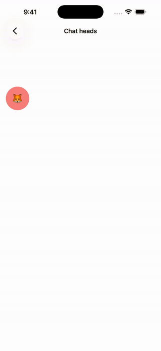

<!-- Generated by tool/gen_examples_docs.py from example_app/lib. Do not edit. -->

# Chat heads

[← Airplane](airplane.md) · [All examples](../EXAMPLES.md) · [Card deck →](card_deck.md)



Drag the front bubble and the others trail behind it. Fling it and it flies to the nearest edge.

Reanimated docs: [fundamentals/handling-gestures](https://docs.swmansion.com/react-native-reanimated/docs/fundamentals/handling-gestures)

## What to look at

- Each follower is `useDerivedAnimation(() => withSpring(ahead.value))`. Its spring restarts whenever the bubble ahead moves and keeps its own velocity, which is what makes the trail smooth.
- On release the front bubble springs to the nearest edge with `velocity:` set to the fling.
- One `GestureDetector` covers the screen, and a drag only starts if it lands on the front bubble.

## Code

The screen comes first, then the components it uses. Shared helpers (`DemoPage`, `Section`, `Stage`, `Palette`, `Buttons`, `ChoiceChips`, `LabeledSlider`) live in `example_app/lib/src/common/` and only do layout.

### `lib/src/screens/chat_heads_screen.dart`

```dart
import 'dart:math' as math;

import 'package:dartnative/dartnative.dart';
import 'package:reanimated_dartnative/reanimated_dartnative.dart';

import '../common/common.dart';
import '../components/chat_head.dart';

/// Chat heads: drag the front bubble and the others trail behind it, each
/// springing toward the one ahead. Let go and it flies to the nearest edge,
/// keeping the velocity of your fling; the chain follows.
///
/// Each follower is `useDerivedAnimation(() => withSpring(ahead.value))`:
/// the spring restarts whenever the bubble ahead moves and inherits its own
/// running velocity, which is what makes the trail smooth.
class ChatHeadsScreen extends StatefulWidget {
  const ChatHeadsScreen({super.key});

  @override
  State<ChatHeadsScreen> createState() => _ChatHeadsScreenState();
}

class _ChatHeadsScreenState extends State<ChatHeadsScreen> with ReanimatedStateMixin {
  static const size = 64.0;
  static const heads = [('🦊', Palette.pink), ('🐼', Palette.blue), ('🐸', Palette.yellow), ('🐙', Palette.purple)];

  late final lead = useSharedValue(const Offset(16, 120));
  late final List<SharedValue<Offset>> chain = _buildChain();

  List<SharedValue<Offset>> _buildChain() {
    final out = <SharedValue<Offset>>[lead];
    for (var i = 1; i < heads.length; i++) {
      final ahead = out[i - 1];
      out.add(useDerivedAnimation(
        ahead.value,
        () => withSpring(ahead.value, dampingRatio: 0.65, duration: const Duration(milliseconds: 300)),
      ));
    }
    return out;
  }

  void onPanEnd(DragEndDetails details, Size area) {
    final v = details.velocity.pixelsPerSecond;
    final p = lead.value;
    // Project where the fling is heading, then snap to that side.
    final projectedX = p.dx + v.dx * 0.2;
    final x = projectedX + size / 2 < area.width / 2 ? 16.0 : area.width - size - 16;
    final y = clamp(p.dy + v.dy * 0.2, 16, area.height - size - 16);
    lead.set(withSpring(Offset(x, y), velocity: v, dampingRatio: 0.7, duration: const Duration(milliseconds: 600)));
  }

  /// Whether the current drag started on the front bubble.
  bool dragging = false;

  void onPanStart(DragStartDetails details) {
    final center = lead.value + const Offset(size / 2, size / 2);
    final d = details.localPosition - center;
    // Not Offset.distance: in DartNative 1.4.0 it returns the squared length.
    dragging = math.sqrt(d.dx * d.dx + d.dy * d.dy) <= size * 0.75;
    if (dragging) cancelAnimation(lead);
  }

  @override
  Widget build(BuildContext context) => Scaffold(
        appBar: AppBar(title: const Text('Chat heads')),
        body: LayoutBuilder(
          builder: (context, constraints) {
            final area = Size(constraints.maxWidth, constraints.maxHeight);
            // One detector over the whole area: the bubbles move by
            // transform, and a transformed view's touch area stays where it
            // was laid out, so the drag is caught here and started only when
            // it lands on the front bubble.
            return GestureDetector(
              behavior: HitTestBehavior.opaque,
              onPanStart: onPanStart,
              onPanUpdate: (d) {
                if (dragging) lead.value = lead.value + d.delta;
              },
              onPanEnd: (d) {
                if (dragging) onPanEnd(d, area);
                dragging = false;
              },
              child: Stack(
                children: [
                  SizedBox(width: area.width, height: area.height),
                  const Positioned(
                    left: 24,
                    right: 24,
                    bottom: 40,
                    child: Text(
                      'Drag the front bubble and fling it toward either side.',
                      textAlign: TextAlign.center,
                      style: TextStyle(color: Color(0xFF8A8FA3)),
                    ),
                  ),
                  // Followers first, so the lead is drawn on top.
                  for (var i = heads.length - 1; i >= 0; i--)
                    Positioned(
                      left: 0,
                      top: 0,
                      child: ChatHead(position: chain[i], color: heads[i].$2, label: heads[i].$1, size: size),
                    ),
                ],
              ),
            );
          },
        ),
      );
}
```

### `lib/src/components/chat_head.dart`

```dart
import 'package:dartnative/dartnative.dart';
import 'package:reanimated_dartnative/reanimated_dartnative.dart';

/// One bubble of the chat heads, drawn wherever [position] says.
class ChatHead extends StatefulWidget {
  const ChatHead({
    super.key,
    required this.position,
    required this.color,
    required this.label,
    this.size = 64,
  });

  final SharedValue<Offset> position;
  final Color color;
  final String label;
  final double size;

  @override
  State<ChatHead> createState() => _ChatHeadState();
}

class _ChatHeadState extends State<ChatHead> with ReanimatedStateMixin {
  late final style = useAnimatedStyle(() => AnimatedStyle(
        translateX: widget.position.value.dx,
        translateY: widget.position.value.dy,
      ));

  @override
  Widget build(BuildContext context) => AnimatedView(
        style: Styles([
          AnimatedStyle(
            width: widget.size,
            height: widget.size,
            borderRadius: widget.size / 2,
            backgroundColor: widget.color,
          ),
          style,
        ]),
        child: Center(
          child: Text(widget.label, style: TextStyle(fontSize: widget.size * 0.42)),
        ),
      );
}
```

[← Airplane](airplane.md) · [All examples](../EXAMPLES.md) · [Card deck →](card_deck.md)
