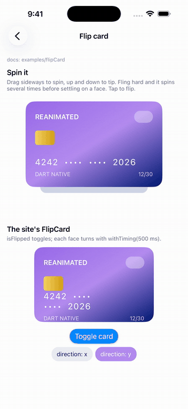

<!-- Generated by tool/gen_examples_docs.py from example_app/lib. Do not edit. -->

# Flip card

[← Bottom sheet](bottom_sheet.md) · [All examples](../EXAMPLES.md) · [Floating action button →](floating_action_button.md)



A card you spin in 3D with your finger, and the site's toggle-driven flip card.

Reanimated docs: [examples/flipCard](https://docs.swmansion.com/react-native-reanimated/examples/flipCard)

## What to look at

- Two faces turn together, the back half a turn (π) ahead of the front; `backfaceVisibility: false` hides whichever faces away.
- `SpinnableCard` turns drags into rotation. On release it snaps to the face the fling is heading for, keeping the fling's angular velocity.
- `FlipCard` is the site's version: `withTiming` between 0 and π whenever `isFlipped` changes.

## Code

The screen comes first, then the components it uses. Shared helpers (`DemoPage`, `Section`, `Stage`, `Palette`, `Buttons`, `ChoiceChips`, `LabeledSlider`) live in `example_app/lib/src/common/` and only do layout.

### `lib/src/screens/flip_card_screen.dart`

```dart
import 'package:dartnative/dartnative.dart';
import 'package:reanimated_dartnative/reanimated_dartnative.dart';

import '../common/common.dart';
import '../components/credit_card_faces.dart';
import '../components/flip_card.dart';
import '../components/spinnable_card.dart';

/// examples/flipCard: the site's toggle-driven flip card, and a card you
/// spin with your finger in 3D.
class FlipCardScreen extends StatefulWidget {
  const FlipCardScreen({super.key});

  @override
  State<FlipCardScreen> createState() => _FlipCardScreenState();
}

class _FlipCardScreenState extends State<FlipCardScreen> with ReanimatedStateMixin {
  late final isFlipped = useSharedValue(false);
  FlipDirection direction = FlipDirection.y;

  @override
  Widget build(BuildContext context) => DemoPage(
        title: 'Flip card',
        docs: 'examples/flipCard',
        child: Column(
          children: [
            const Section(
              title: 'Spin it',
              note: 'Drag sideways to spin, up and down to tip. Fling hard and it '
                  'spins several times before settling on a face. Tap to flip.',
              child: Center(
                child: SpinnableCard(front: CreditCardFront(), back: CreditCardBack()),
              ),
            ),
            Section(
              title: 'The site\'s FlipCard',
              note: 'isFlipped toggles; each face turns with withTiming(500 ms).',
              child: Column(
                children: [
                  FlipCard(
                    key: ValueKey(direction),
                    isFlipped: isFlipped,
                    direction: direction,
                    regularContent: const SizedBox(width: 280, height: 175, child: CreditCardFront()),
                    flippedContent: const SizedBox(width: 280, height: 175, child: CreditCardBack()),
                  ),
                  const SizedBox(height: 16),
                  ElevatedButton(
                    onPressed: () => isFlipped.value = !isFlipped.value,
                    child: const Text('Toggle card'),
                  ),
                  const SizedBox(height: 8),
                  ChoiceChips<FlipDirection>(
                    options: FlipDirection.values,
                    selected: direction,
                    label: (d) => 'direction: ${d.name}',
                    onSelected: (d) => setState(() {
                      direction = d;
                      isFlipped.value = false;
                    }),
                  ),
                ],
              ),
            ),
          ],
        ),
      );
}
```

### `lib/src/components/credit_card_faces.dart`

```dart
import 'package:dartnative/dartnative.dart';

import '../common/common.dart';

const _white = Color(0xFFFFFFFF);

/// The front of the flip card demo's credit card.
class CreditCardFront extends StatelessWidget {
  const CreditCardFront({super.key});

  @override
  Widget build(BuildContext context) => Container(
        padding: const EdgeInsets.all(22),
        decoration: BoxDecoration(
          borderRadius: BorderRadius.circular(20),
          gradient: const LinearGradient(
            begin: Alignment.topLeft,
            end: Alignment.bottomRight,
            colors: [Color(0xFF9A6BEA), Palette.purple, Palette.navy],
          ),
        ),
        child: Column(
          crossAxisAlignment: CrossAxisAlignment.start,
          children: [
            Row(children: [
              const Text('REANIMATED', style: TextStyle(color: _white, fontSize: 16, fontWeight: FontWeight.w600)),
              const Spacer(),
              Container(
                width: 44,
                height: 28,
                decoration: BoxDecoration(color: const Color(0x55FFFFFF), borderRadius: BorderRadius.circular(14)),
              ),
            ]),
            const SizedBox(height: 18),
            Container(
              width: 46,
              height: 34,
              decoration: BoxDecoration(
                borderRadius: BorderRadius.circular(6),
                gradient: const LinearGradient(colors: [Color(0xFFF6D365), Color(0xFFD4A017)]),
              ),
            ),
            const Spacer(),
            const Text('4242  ••••  ••••  2026',
                style: TextStyle(color: _white, fontSize: 20, letterSpacing: 2)),
            const SizedBox(height: 8),
            const Row(children: [
              Text('DART NATIVE', style: TextStyle(color: Color(0xCCFFFFFF), fontSize: 13)),
              Spacer(),
              Text('12/30', style: TextStyle(color: Color(0xCCFFFFFF), fontSize: 13)),
            ]),
          ],
        ),
      );
}

/// The back of the flip card demo's credit card.
class CreditCardBack extends StatelessWidget {
  const CreditCardBack({super.key});

  @override
  Widget build(BuildContext context) => Container(
        decoration: BoxDecoration(
          borderRadius: BorderRadius.circular(20),
          gradient: const LinearGradient(
            begin: Alignment.topRight,
            end: Alignment.bottomLeft,
            colors: [Palette.navy, Color(0xFF2A1B5C)],
          ),
        ),
        child: Column(
          crossAxisAlignment: CrossAxisAlignment.stretch,
          children: [
            const SizedBox(height: 26),
            Container(height: 40, color: const Color(0xFF0B0B12)),
            const SizedBox(height: 18),
            Padding(
              padding: const EdgeInsets.symmetric(horizontal: 22),
              child: Row(children: [
                Expanded(
                  child: Container(
                    height: 34,
                    color: const Color(0xFFEDEEF4),
                    alignment: Alignment.centerLeft,
                    padding: const EdgeInsets.only(left: 10),
                    child: const Text('signature', style: TextStyle(color: Color(0xFF8A8FA3))),
                  ),
                ),
                Container(
                  width: 54,
                  height: 34,
                  color: _white,
                  alignment: Alignment.center,
                  child: const Text('123', style: TextStyle(color: Palette.navy, fontSize: 16)),
                ),
              ]),
            ),
            const Spacer(),
            const Padding(
              padding: EdgeInsets.fromLTRB(22, 0, 22, 18),
              child: Text('Spun with withSpring · velocity carried from your fling',
                  style: TextStyle(color: Color(0x99FFFFFF), fontSize: 12)),
            ),
          ],
        ),
      );
}
```

### `lib/src/components/flip_card.dart`

```dart
import 'dart:math' as math;

import 'package:dartnative/dartnative.dart';
import 'package:reanimated_dartnative/reanimated_dartnative.dart';

/// Which axis a [FlipCard] turns about.
enum FlipDirection { x, y }

/// The Reanimated site's `FlipCard`: the front turns 0° → 180° and the back
/// 180° → 360° with withTiming, both with their backface hidden, so one
/// face always shows.
class FlipCard extends StatefulWidget {
  const FlipCard({
    super.key,
    required this.isFlipped,
    required this.regularContent,
    required this.flippedContent,
    this.direction = FlipDirection.y,
    this.duration = const Duration(milliseconds: 500),
  });

  final SharedValue<bool> isFlipped;
  final Widget regularContent;
  final Widget flippedContent;
  final FlipDirection direction;
  final Duration duration;

  @override
  State<FlipCard> createState() => _FlipCardState();
}

class _FlipCardState extends State<FlipCard> with ReanimatedStateMixin {
  // The Reanimated original is:
  //   withTiming(interpolate(Number(isFlipped.value), [0, 1], [0, 180]))
  // Here the angle is in radians: 0 for the front, π for the back.
  late final spin = useDerivedAnimation(
    0.0,
    () => withTiming(
      interpolate(widget.isFlipped.value ? 1 : 0, [0, 1], [0, math.pi]),
      duration: widget.duration,
    ),
  );

  AnimatedStyle _rotation(double angle) => widget.direction == FlipDirection.x
      ? AnimatedStyle(rotateX: angle, perspective: 1000)
      : AnimatedStyle(rotateY: angle, perspective: 1000);

  late final regularCardAnimatedStyle = useAnimatedStyle(() => _rotation(spin.value));
  late final flippedCardAnimatedStyle = useAnimatedStyle(() => _rotation(spin.value + math.pi));

  @override
  Widget build(BuildContext context) => Stack(
        children: [
          AnimatedView(
            style: regularCardAnimatedStyle,
            backfaceVisibility: false,
            child: widget.regularContent,
          ),
          Positioned(
            left: 0,
            top: 0,
            right: 0,
            bottom: 0,
            child: AnimatedView(
              style: flippedCardAnimatedStyle,
              backfaceVisibility: false,
              child: widget.flippedContent,
            ),
          ),
        ],
      );
}
```

### `lib/src/components/spinnable_card.dart`

```dart
import 'dart:math' as math;

import 'package:dartnative/dartnative.dart';
import 'package:reanimated_dartnative/reanimated_dartnative.dart';

/// A two-faced card you spin with your finger.
///
/// Horizontal drags turn it about its vertical axis and vertical drags tip
/// it toward you. On release it snaps to whichever face the fling is
/// heading for, keeping the fling's velocity, so a hard flick spins it
/// several times before settling. While held it lifts (scale and shadow).
/// A tap flips it.
class SpinnableCard extends StatefulWidget {
  const SpinnableCard({
    super.key,
    required this.front,
    required this.back,
    this.width = 320,
    this.height = 200,
  });

  final Widget front;
  final Widget back;
  final double width;
  final double height;

  @override
  State<SpinnableCard> createState() => _SpinnableCardState();
}

class _SpinnableCardState extends State<SpinnableCard> with ReanimatedStateMixin {
  /// Rotation about the vertical axis, radians.
  late final spin = useSharedValue(0.0);

  /// Tip toward the viewer, radians.
  late final tilt = useSharedValue(0.0);
  late final held = useSharedValue(false);

  late final lift = useDerivedAnimation(0.0, () => withSpring(held.value ? 1.0 : 0.0, dampingRatio: 0.6));

  double get _radiansPerPixel => math.pi / widget.width;

  AnimatedStyle _face(double extra) => AnimatedStyle(
        rotateY: spin.value + extra,
        rotateX: tilt.value,
        perspective: 800,
        scale: 1 + 0.06 * lift.value,
      );

  late final frontStyle = useAnimatedStyle(() => _face(0));
  late final backStyle = useAnimatedStyle(() => _face(math.pi));

  // A soft shadow under the card that spreads and drops as it lifts.
  late final shadowStyle = useAnimatedStyle(() => AnimatedStyle(
        opacity: 0.18 + 0.17 * lift.value,
        scaleX: (0.9 + 0.08 * lift.value) * math.cos(spin.value).abs().clamp(0.35, 1.0),
        translateY: 14 + 16 * lift.value,
      ));

  void onPanEnd(DragEndDetails details) {
    held.value = false;
    final v = details.velocity.pixelsPerSecond;
    final angularVelocity = v.dx * _radiansPerPixel;
    // Where the fling would carry it, rounded to a face.
    final projected = spin.value + angularVelocity * 0.25;
    final target = (projected / math.pi).round() * math.pi;
    spin.set(withSpring(target, velocity: angularVelocity, dampingRatio: 0.65, duration: const Duration(milliseconds: 900)));
    tilt.set(withSpring(0.0, velocity: -v.dy * _radiansPerPixel * 0.4, dampingRatio: 0.5));
  }

  void flip() {
    final target = ((spin.value / math.pi).round() + 1) * math.pi;
    spin.set(withSpring(target, dampingRatio: 0.7, duration: const Duration(milliseconds: 800)));
  }

  @override
  Widget build(BuildContext context) => GestureDetector(
        behavior: HitTestBehavior.opaque,
        onTap: flip,
        onPanStart: (_) {
          held.value = true;
          cancelAnimation(spin);
          cancelAnimation(tilt);
        },
        onPanUpdate: (d) {
          spin.value += d.delta.dx * _radiansPerPixel;
          tilt.value = clamp(tilt.value - d.delta.dy * _radiansPerPixel * 0.5, -0.6, 0.6);
        },
        onPanEnd: onPanEnd,
        child: SizedBox(
          width: widget.width + 40,
          height: widget.height + 70,
          child: Stack(
            children: [
              SizedBox(width: widget.width + 40, height: widget.height + 70),
              Positioned(
                left: 40,
                top: widget.height - 20,
                child: AnimatedView(
                  style: Styles([
                    AnimatedStyle(width: widget.width - 40, height: 30, borderRadius: 15, backgroundColor: const Color(0xFF001A72)),
                    shadowStyle,
                  ]),
                ),
              ),
              Positioned(
                left: 20,
                top: 10,
                child: AnimatedView(
                  style: frontStyle,
                  backfaceVisibility: false,
                  child: SizedBox(width: widget.width, height: widget.height, child: widget.front),
                ),
              ),
              Positioned(
                left: 20,
                top: 10,
                child: AnimatedView(
                  style: backStyle,
                  backfaceVisibility: false,
                  child: SizedBox(width: widget.width, height: widget.height, child: widget.back),
                ),
              ),
            ],
          ),
        ),
      );
}
```

[← Bottom sheet](bottom_sheet.md) · [All examples](../EXAMPLES.md) · [Floating action button →](floating_action_button.md)
